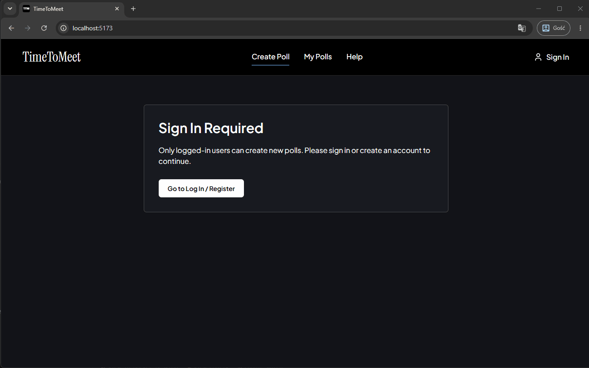

# TimeToMeet

**TimeToMeet** to aplikacja webowa (inspirowana *LettuceMeet*) służąca do szybkiego i wygodnego ustalania wspólnego terminu spotkania dla grupy osób. Uczestnicy zaznaczają swoją dostępność na interaktywnej siatce 30-minutowych bloków czasowych, a aplikacja w czasie rzeczywistym generuje **heatmapę** pokazującą, w których godzinach pasuje największej liczbie osób.

<p align="center">
  
</p>

---

## Główne funkcjonalności

- **Tworzenie ankiet czasowych (Polls):** Wybór dni na kalendarzu (do 60 dni), zakresu godzin siatki (`From` – `To`) oraz strefy czasowej spotkania (IANA Timezones).
- **Głosowanie z kontem lub jako Gość:**
  - **Zalogowani użytkownicy** mogą tworzyć własne ankiety, przeglądać wszystkie swoje spotkania w zakładce *My Polls* oraz w dowolnym momencie edytować swoją dostępność.
  - **Goście** mogą dołączyć do spotkania bezpośrednio z udostępnionego linku (`?session=<id>`) i zagłosować podając jedynie swoje imię/nick – bez konieczności rejestracji.
- **Interaktywna siatka i Heatmapa na żywo:**
  - Szybkie zaznaczanie przedziałów przeciągnięciem myszy (*drag-to-select*) lub dotykiem na urządzeniach mobilnych.
  - Automatyczna synchronizacja (polling co 3 sekundy) z ochroną niezapisanych zmian.
  - Tryb **Inspect**: podgląd kto dokładnie jest dostępny w danym 30-minutowym slocie oraz możliwość kliknięcia wybranego uczestnika na liście, aby podświetlić na siatce wyłącznie jego godziny.
- **Zamykanie ankiety i podsumowanie wyników:**
  - Twórca ankiety może zamknąć głosowanie (*Close Poll*), co uruchamia widok **Best Matches** oraz **Matching Dates** – automatycznie łączący sąsiadujące sloty w gotowe przedziały czasowe o najwyższej frekwencji.
- **Moderacja spotkania:** Twórca grupy może usuwać wybrane przedziały czasowe, pojedynczych uczestników lub całą ankietę.
- **Dostępność (Accessibility / Color-Blind Friendly UX):** Interfejs oraz siatka dostępności zostały zaprojektowane z myślą o osobach z zaburzeniami rozpoznawania barw (daltonizmem). Zamiast polegać na problematycznych odcieniach czerwieni i zieleni, aplikacja wykorzystuje naukowo opracowaną paletę kolorów **Paul Tol** (bezpieczną dla różnych typów ślepoty barw), a także dodatkowe wskaźniki niezależne od koloru: wizualne paski postępu (proporcjonalne wypełnienie szerokości kafelka `0–100%`), wyraźne ikony wyboru (`✓`), obramowania oraz etykiety liczbowe (np. `3/4`).

---

## Stos technologiczny (Tech Stack)

### Backend (`/backend`)
- **Python 3.12** + **FastAPI**
- **SQLAlchemy 2.x** + **SQLite** (baza danych)
- **Pydantic v2** & **Pydantic Settings** (walidacja danych i konfiguracja)
- **JWT (JSON Web Tokens)** + **Passlib / Bcrypt** (autoryzacja OAuth2 Bearer)

### Frontend (`/frontend`)
- **React 19** + **TypeScript**
- **Vite**
- **Tailwind CSS v4**

### Konteneryzacja
- **Docker** & **Docker Compose**

---

## Instrukcja uruchomienia

Projekt można uruchomić na dwa sposoby: **jedną komendą przez Docker Compose (zalecane)** lub **lokalnie bez Dockera**.

---

### Sposób 1: Uruchomienie przez Docker Compose (Zalecane)

Wymagania: zainstalowany i uruchomiony [Docker Desktop](https://www.docker.com/products/docker-desktop/) (lub Docker Engine + Docker Compose).

1. **Sklonuj repozytorium i przejdź do katalogu projektu:**
   ```bash
   git clone <URL_REPOZYTORIUM>
   cd TimeToMeet
   ```

2. **Zbuduj i uruchom kontenery jedną komendą:**
   ```bash
   docker compose up --build
   ```
   *(Nie musisz ręcznie tworzyć pliku `.env` – w `docker-compose.yml` skonfigurowane są domyślne zmienne środowiskowe do uruchomienia deweloperskiego).*

3. **Otwórz aplikację w przeglądarce:**
   - **Aplikacja Frontend:** [http://localhost:5173](http://localhost:5173)
   - **Backend API:** [http://localhost:8000](http://localhost:8000)
   - **Dokumentacja API (Swagger UI):** [http://localhost:8000/docs](http://localhost:8000/docs)

4. **Zatrzymanie aplikacji:**
   Wciśnij `Ctrl + C` w terminalu lub wpisz:
   ```bash
   docker compose down
   ```

---

### Sposób 2: Uruchomienie lokalne (bez Dockera)

Wymagania: **Python 3.11+** oraz **Node.js 20+ (z npm)**.

#### Krok 1: Uruchomienie Backendu (Terminal 1)

1. Przejdź do folderu `backend`:
   ```bash
   cd backend
   ```
2. Utwórz i aktywuj środowisko wirtualne:
   - **Windows (PowerShell):**
     ```powershell
     python -m venv venv
     .\venv\Scripts\Activate.ps1
     ```
   - **Linux / macOS:**
     ```bash
     python3 -m venv venv
     source venv/bin/activate
     ```
3. Zainstaluj zależności:
   ```bash
   pip install -r requirements.txt
   ```
4. Utwórz w katalogu `backend/` plik `.env` z konfiguracją JWT:
   ```env
   SECRET_KEY=dev_secret_key_change_in_production_123
   ALGORITHM=HS256
   ACCESS_TOKEN_EXPIRE_MINUTES=1440
   ```
5. Uruchom serwer FastAPI:
   ```bash
   uvicorn main:app --host 127.0.0.1 --port 8000 --reload
   ```
   Backend będzie dostępny pod adresem `http://127.0.0.1:8000` (Swagger UI: `http://127.0.0.1:8000/docs`).

#### Krok 2: Uruchomienie Frontendu (Terminal 2)

1. W nowym oknie terminala przejdź do folderu `frontend`:
   ```bash
   cd frontend
   ```
2. Zainstaluj paczki npm i uruchom serwer deweloperski Vite:
   ```bash
   npm install
   npm run dev
   ```
3. Otwórz w przeglądarce adres wyświetlony w terminalu: [http://localhost:5173](http://localhost:5173).

---

## Struktura projektu

```text
TimeToMeet/
├── backend/
│   ├── main.py            # Endpointy FastAPI, konfiguracja CORS i migracja startowa
│   ├── models.py          # Modele ORM SQLAlchemy (User, Group, GroupDay, Availability)
│   ├── schemas.py         # Schematy walidacji Pydantic v2
│   ├── logic.py           # Algorytm obliczania nakładania się przedziałów (Heatmap)
│   ├── auth.py            # Obsługa JWT, haszowania haseł i zależności autoryzacji
│   ├── database.py        # Konfiguracja połączenia z bazą SQLite
│   ├── config.py          # Konfiguracja zmiennych środowiskowych (.env)
│   ├── requirements.txt   # Lista zależności Pythona
│   └── Dockerfile         # Obraz Docker dla backendu
├── frontend/
│   ├── public/            # Statyczne zasoby (favicon TTM)
│   ├── src/
│   │   ├── api.ts         # Klient komunikacji z REST API
│   │   ├── types.ts       # Interfejsy TypeScript
│   │   ├── App.tsx        # Główny komponent aplikacji i nawigacja
│   │   └── components/    # Widoki (HomePage, CreateGroupPage, LoginPage, SessionPage + podkomponenty)
│   ├── package.json       # Zależności i skrypty frontendu
│   ├── vite.config.ts     # Konfiguracja Vite i proxy /api
│   └── Dockerfile         # Obraz Docker dla frontendu
├── docker-compose.yml     # Uruchamianie całego środowiska jedną komendą
└── README.md              # Dokumentacja projektu i instrukcja uruchomienia
```

---

## Główne endpointy REST API

| Metoda | Endpoint | Opis | Autoryzacja |
| :--- | :--- | :--- | :--- |
| `POST` | `/register` | Rejestracja nowego użytkownika | Publiczny |
| `POST` | `/login` | Logowanie (`OAuth2PasswordRequestForm`) i pobranie tokenu JWT | Publiczny |
| `GET` | `/users/me` | Pobranie profilu aktualnie zalogowanego użytkownika | Bearer JWT |
| `POST` | `/groups` | Utworzenie nowej grupy/ankiety wraz z wybranymi dniami | Bearer JWT |
| `GET` | `/groups` | Lista ankiet utworzonych przez użytkownika oraz tych, w których głosował | Bearer JWT |
| `GET` | `/groups/{group_id}` | Pobranie szczegółów pojedynczej ankiety | Publiczny |
| `PATCH` | `/groups/{group_id}` | Edycja ustawień ankiety / otwarcie lub zamknięcie głosowania (`is_closed`) | Twórca (JWT) |
| `DELETE` | `/groups/{group_id}` | Usunięcie ankiety wraz ze wszystkimi głosami | Twórca (JWT) |
| `POST` | `/groups/{group_id}/availabilities` | Zapisanie/aktualizacja dostępności (obsługuje zalogowanych i gości) | Opcjonalny |
| `GET` | `/groups/{group_id}/availabilities` | Pobranie wszystkich przedziałów dostępności w danej grupie | Publiczny |
| `GET` | `/groups/{group_id}/availabilities/me` | Pobranie przedziałów dostępności zalogowanego użytkownika | Bearer JWT |
| `DELETE` | `/groups/{group_id}/availabilities` | Wyczyszczenie własnych wyborów w danej ankiecie | JWT / Gość |
| `DELETE` | `/groups/{group_id}/participants/{user_id}` | Usunięcie uczestnika z ankiety | Twórca / Właściciel |
| `DELETE` | `/groups/{group_id}/availabilities/{id}` | Usunięcie pojedynczego przedziału czasowego | Twórca / Właściciel |
| `GET` | `/groups/{group_id}/heatmap` | Obliczona heatmapa (`total_participants`, `heatmap`, `available_users`) | Publiczny |

---

## Wykorzystanie narzędzi AI

Podczas prac nad projektem wspomagaliśmy się narzędziami AI (model **Argon** w środowisku **Antigravity** oraz **Gemini 3.8 Pro** w przeglądarce):
- **Backend:** pisany w dużej mierze samodzielnie, z wykorzystaniem AI głównie do konsultacji architektonicznych, code review oraz weryfikacji przypadków brzegowych.
- **Frontend:** tworzony z wsparciem powyższych narzędzi przy budowie komponentów interfejsu i stylowaniu widoków.

